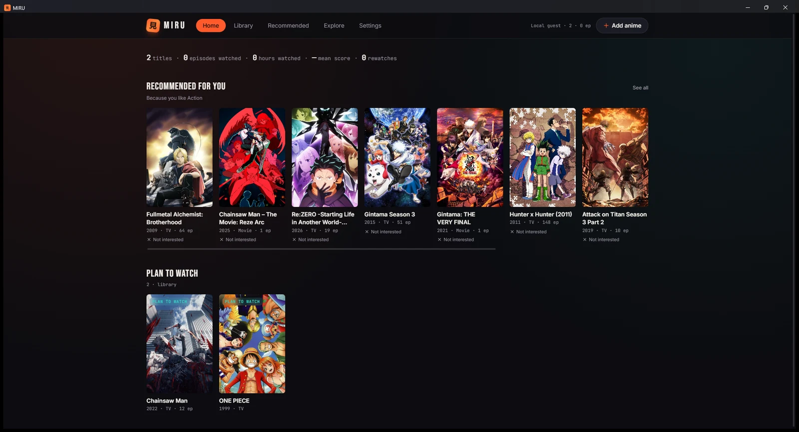
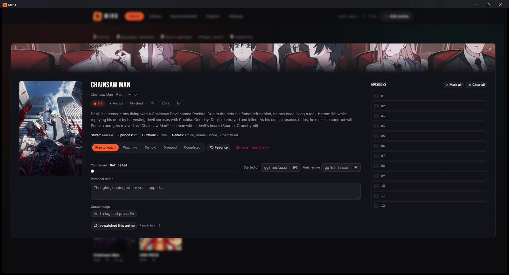
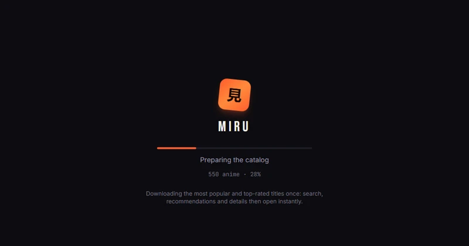

<p align="center">
  
</p>

<h1 align="center">MIRU</h1>

<p align="center">Your anime diary.<br/>
Desktop app for Windows: episode progress, ratings, notes, tags and discovery from Jikan, AniList and Kitsu.</p>

<p align="center">
  <strong>English</strong> · <a href="README.it.md">Italiano</a>
</p>

<p align="center">
  
  
  
  
  
</p>

<p align="center">
  
  
  <br/>
  <sub>Home with recommendations and library · anime detail with episodes and status</sub>
</p>

<p align="center">
  
  <br/>
  <sub>Explore: filters by type, status, year, episodes, studio, genres and minimum score</sub>
</p>

<p align="center">
  
  <br/>
  <sub>First launch: the catalog (~1200 titles) is downloaded once</sub>
</p>

MIRU is a local anime tracker. The UI is Next.js 16 (App Router, React 19, Tailwind v4, shadcn/base-ui); the desktop shell is Tauri v2 — a native WebView2 window, no browser, no Node.js at runtime. The interface is available in English and Italian, with the language picked from your system on first launch (change it in Settings → Language).

## Features

- **Library** with statuses (plan to watch, watching, on hold, completed, dropped), favourites, personal score, notes and custom tags.
- **Episode progress** checkbox by checkbox, with "mark all" and pagination for long series.
- **Activity log** per title: additions, status changes, watched episodes, ratings.
- **Recommendations** derived from the genres you actually follow, with "not interested" to filter them out.
- **Explore** with filters (type, status, year, episodes, studio, genres, minimum score) and sorting.
- **Search** with one-click add to the library.
- **Export / import** of the library as JSON, preferences and history included.
- **English / Italian UI**, dark theme, fluid layout from 900 px up (no horizontal overflow, verified at 900/1024/1280/1440/1920).

## Requirements

| For | You need |
|---|---|
| Running the exe | Windows 10/11 and the [WebView2 Runtime](https://developer.microsoft.com/microsoft-edge/webview2/) (preinstalled on Windows 11) |
| Building the exe | Node 20.9+, Rust stable (`x86_64-pc-windows-msvc`) and Visual Studio Build Tools with the "Desktop development with C++" workload |
| Web development | Node 20.9+ only |

## Quick start

```bash
git clone https://github.com/terzastella/miru.git
cd miru
npm install
npm run dev
```

Open `http://localhost:3000`.

## Desktop app

```bash
npm run desktop:dev        # Tauri window against the Next dev server (hot reload)
npm run desktop:build      # exe in src-tauri/target/release
npm run desktop:portable   # exe + copy to dist/MIRU.exe
```

`dist/MIRU.exe` is portable: no installer, no Node.js, a single file (~15 MB). On Windows the first launch shows a loading screen that downloads the local catalog (~1200 titles from AniList, ~15 s, once); on later launches search, Explore and Recommendations are instant.

`scripts/tauri.mjs` looks for `vcvars64.bat` and prepares the MSVC environment before calling the Tauri CLI; if your Build Tools live elsewhere, add the path to the list at the top of that file.

## Data and privacy

Everything stays on your machine: no account, no backend, no telemetry.

- library, preferences and activity: the webview's `localStorage`;
- prefetched catalog: IndexedDB (7-day TTL);
- location: `%LOCALAPPDATA%\app.miru.desktop` (moving the exe keeps your data).

The only network requests go to [Jikan](https://jikan.moe/), [AniList](https://anilist.co/) and [Kitsu](https://kitsu.io/) to search anime and read their details.

## How it works

- `MIRU_DESKTOP=1 next build` produces a static export in `out/`, packaged into the exe.
- API routes live in `app/api/**/route.handler.ts`: the `handler.ts` extension is enabled only in the web build (`pageExtensions` in `next.config.mjs`), so the desktop build leaves them out.
- There is no server in the desktop app: `lib/anime-api.ts` answers the same `/api/anime/*` paths by running `lib/anime-sources.ts` inside the webview and returning an equivalent `Response` — components can't tell the difference.
- The local catalog (`lib/catalog.ts`) is queried before the network and applies the same filters and sorting to stored data.
- Calls to the external APIs leave from the Rust process (`lib/net.ts` → `@tauri-apps/plugin-http`): no CORS involved. Allowed hosts live in `src-tauri/capabilities/default.json`.
- The source fallback chain is Jikan → AniList → Kitsu → in-memory cache, so one slow endpoint doesn't take the app down.

## Project structure

```
app/               App Router pages, layout, API routes (web only)
components/        shell, cards, dialogs, views and UI primitives (shadcn/base-ui)
lib/               local store, i18n, anime sources, catalog, desktop adapter
public/            static assets
scripts/           desktop build, MSVC wrapper for Tauri, layout check
src-tauri/         Tauri shell: conf, capabilities, icons, Rust code
tools/             icon generation, legacy launcher (unused by the exe)
docs/              documentation and screenshots
```

## Known limits

- The desktop app is **Windows only** (WebView2). The web version runs anywhere.
- The prefetched catalog is the ~1200 most popular and top-rated titles, not the whole AniList database: niche searches go to the network.
- If Jikan doesn't answer (rate limit or a network that blocks it) the first attempt costs ~7 s before falling back to AniList.
- CSP is enabled in `tauri.conf.json`: `default-src 'self'`, inline script/style (required by the static Next export), `img-src` limited to the cover CDNs used by Jikan, AniList and Kitsu, and `connect-src` limited to Tauri's IPC (external calls go through the Rust HTTP plugin).
- No backend, no authentication, no cross-device sync: your data lives on one machine.

## License

[MIT](LICENSE) © 2026 Terzastella

## Credits

Data and images belong to their respective sources: [Jikan](https://jikan.moe/) (MyAnimeList), [AniList](https://anilist.co/), [Kitsu](https://kitsu.io/). UI built with [shadcn/ui](https://ui.shadcn.com/), [Base UI](https://base-ui.com/), [Lucide](https://lucide.dev/) and the Bebas Neue, Inter and JetBrains Mono fonts from Google Fonts. Initial scaffold generated with [v0](https://v0.app).
