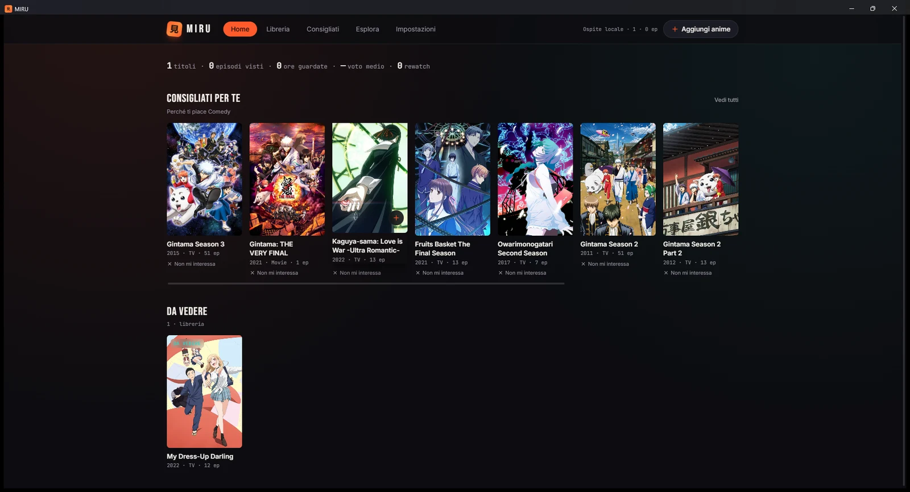
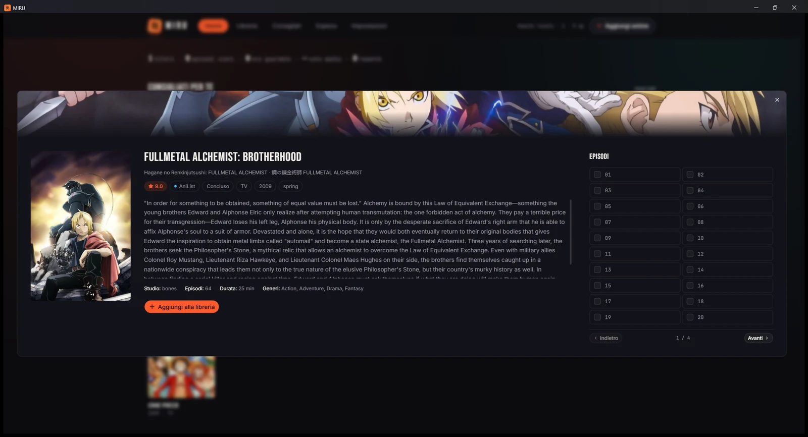
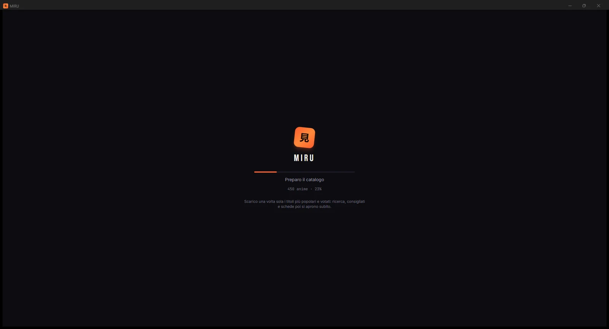
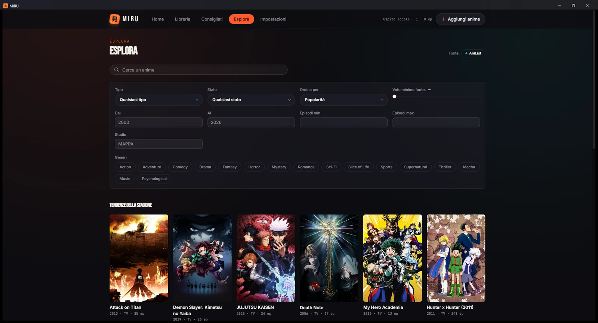

<p align="center">
  
</p>

<h1 align="center">MIRU</h1>

<p align="center">Il tuo diario anime.<br/>
App desktop per Windows: progresso episodi, voti, note, tag e scoperta di nuovi titoli da Jikan, AniList e Kitsu.</p>

<p align="center">
  
  
  
  
  
</p>

<p align="center">
  
  
</p>

<p align="center">
  
  
</p>

MIRU è un tracker anime locale. La UI è Next.js 16 (App Router, React 19, Tailwind v4, shadcn/base-ui), il guscio desktop è Tauri v2: una finestra nativa WebView2, nessun browser, nessun Node.js a runtime.

## Funzioni

- **Libreria** con stati (da vedere, in corso, in pausa, completati, droppati), preferiti, voto personale, note e tag personalizzati.
- **Progresso episodi** casella per casella, con "segna tutti" e paginazione per serie lunghe (One Piece docet).
- **Registro attività** per ogni titolo: aggiunte, cambi stato, episodi visti, voti.
- **Consigliati** calcolati dai generi che segui davvero, con "non mi interessa" per scremare.
- **Esplora** con filtri (tipo, stato, anno, episodi, studio, generi, voto minimo) e ordinamenti.
- **Ricerca** con aggiunta rapida alla libreria.
- **Export / import** della libreria in JSON, con preferenze e storico.
- **Interfaccia IT/EN**, tema scuro, layout fluido da 900 px in su (nessun overflow orizzontale, verificato a 900/1024/1280/1440/1920).

## Requisiti

| Serve per | Cosa |
|---|---|
| Usare l'exe | Windows 10/11 e [WebView2 Runtime](https://developer.microsoft.com/microsoft-edge/webview2/) (preinstallato su Windows 11) |
| Compilare l'exe | Node 20.9+, Rust stable (target `x86_64-pc-windows-msvc`) e Visual Studio Build Tools con workload "Desktop development with C++" |
| Sviluppo web | Solo Node 20.9+ |

## Avvio rapido

```bash
git clone https://github.com/terzastella/miru.git
cd miru
npm install
npm run dev
```

Apri `http://localhost:3000`.

## App desktop

```bash
npm run desktop:dev        # finestra Tauri contro il dev server Next (hot reload)
npm run desktop:build      # exe in src-tauri/target/release
npm run desktop:portable   # exe + copia in dist/MIRU.exe
```

`dist/MIRU.exe` è portabile: nessuna installazione, nessun Node.js, un solo file (~15 MB). Su Windows al primo avvio mostra una schermata di caricamento che scarica il catalogo locale (~1200 titoli da AniList, ~15 s, una volta sola); dagli avvii successivi ricerca, Esplora e Consigliati sono immediati.

`scripts/tauri.mjs` cerca `vcvars64.bat` e prepara l'ambiente MSVC prima di chiamare la CLI Tauri; se i Build Tools stanno in un percorso diverso, basta aggiungerlo all'elenco in cima al file.

## Dati e privacy

Tutto è locale: nessun account, nessun backend, nessuna telemetria.

- libreria, preferenze e attività: `localStorage` della webview;
- catalogo precaricato: IndexedDB (TTL 7 giorni);
- posizione: `%LOCALAPPDATA%\app.miru.desktop` (spostando l'exe i dati restano lì).

Le uniche richieste di rete sono verso [Jikan](https://jikan.moe/), [AniList](https://anilist.co/) e [Kitsu](https://kitsu.io/) per cercare anime e leggerne le schede.

## Come è fatto

- `MIRU_DESKTOP=1 next build` produce un export statico in `out/`, impacchettato nell'exe.
- Le route API vivono in `app/api/**/route.handler.ts`: l'estensione `handler.ts` è abilitata solo nella build web (`pageExtensions` in `next.config.mjs`), così il build desktop non le include.
- Nel desktop non c'è un server: `lib/anime-api.ts` risponde agli stessi path `/api/anime/*` eseguendo `lib/anime-sources.ts` dentro la webview e restituendo una `Response` equivalente — i componenti non sanno nulla della differenza.
- Prima della rete viene consultato il catalogo locale (`lib/catalog.ts`), che applica gli stessi filtri e ordinamenti sui dati salvati.
- Le chiamate alle API esterne escono dal processo Rust (`lib/net.ts` → `@tauri-apps/plugin-http`): nessun vincolo CORS. Gli host consentiti sono in `src-tauri/capabilities/default.json`.
- La catena di fallback delle sorgenti è Jikan → AniList → Kitsu → cache in memoria, così un endpoint lento non spegne l'app.

## Struttura

```
app/               pagine App Router, layout, route API (solo web)
components/        shell, card, dialoghi, viste e primitive UI (shadcn/base-ui)
lib/               store locale, i18n, sorgenti anime, catalogo, adapter desktop
public/            asset statici
scripts/           build desktop, wrapper MSVC per Tauri, verifica layout
src-tauri/         guscio Tauri: conf, capability, icone, codice Rust
tools/             generazione icona, vecchio launcher (non usato dall'exe)
docs/              documentazione e screenshot
```

## Limiti noti

- L'app desktop è **solo Windows** (WebView2). La versione web gira ovunque.
- Il catalogo precaricato sono i ~1200 titoli più popolari e più votati, non l'intero database AniList: una ricerca di nicchia esce in rete.
- Se Jikan non risponde (rate limit o rete che lo blocca) il primo tentativo costa ~7 s prima del fallback AniList.
- CSP disattivata (`csp: null` in `tauri.conf.json`): da irrigidire quando il set di host esterni sarà stabile.
- Nessun backend, nessuna autenticazione, nessuna sincronizzazione tra dispositivi: i dati stanno su una macchina sola.

## Licenza

[MIT](LICENSE) © 2026 Terzastella

## Crediti

Dati e immagini appartengono alle rispettive fonti: [Jikan](https://jikan.moe/) (MyAnimeList), [AniList](https://anilist.co/), [Kitsu](https://kitsu.io/). UI costruita con [shadcn/ui](https://ui.shadcn.com/), [Base UI](https://base-ui.com/), [Lucide](https://lucide.dev/) e i font Bebas Neue, Inter e JetBrains Mono di Google Fonts. Scaffold iniziale generato con [v0](https://v0.app).
